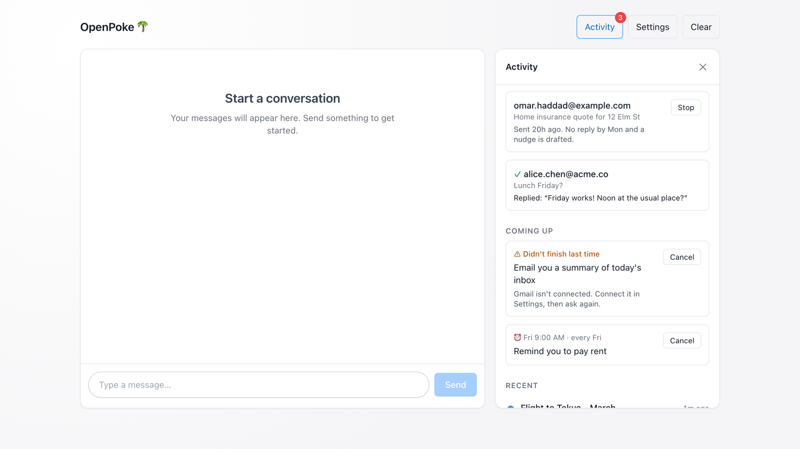

# Write-up

OpenPoke has one assistant you text ("Poke") that hands work to persistent worker agents ("Email to Alice", "Rent reminder"). I made three changes, all aimed at one idea: **you can see what the assistant actually did, and nothing irreversible happens by accident.**

Numbers are labelled **MEASURED** (I ran it), **TARGET** (a goal I chose), or **GUESS** (a starting value to tune).

---

## Part 1: Execution agent overload

### The problem
Poke picked a worker by retyping its exact name, and every worker ever created was pasted into every prompt. The root cause: **one field, the name, was doing three jobs** — the agent's ID, its only description (`"Handle tasks related to: {name}"`), and its log filename. Consequences:

- Any small mismatch ("email to alice" vs "Email to Alice") **silently created a new agent with no memory**. Worse, the log filename lowercases names, so the two agents **shared one log file**.
- Prompt size grew with every agent: about **6,000 tokens of agent names at 500 agents** (MEASURED, characters ÷ 4).
- With hundreds of similar agents, Poke had to guess between lookalikes.

### What I changed
| Change | Why |
|---|---|
| Agents are looked up by a normalized name, reusing the function that already names log files | One identity per agent; roster and logs can't disagree. Old rosters with case duplicates collapse into one on load. |
| Each agent has a description and a last-used time | Search needs something to read; the worker's prompt now states its real purpose. Old agents get a description from their first request. |
| Poke sees only the **20 most recently used** agents (GUESS) plus a count of hidden ones | The prompt stops growing. Any run counts as "use", including reminder runs, so an agent that just reported back is always visible. |
| A `find_agents` search tool, ranking rare words higher | Finds hidden agents. "email" appears in hundreds of agents and barely counts; "lisbon" appears in one and counts a lot (the core idea of BM25, ~10 lines of standard library). |
| An unknown name sends nothing and returns the closest matches; creating an agent requires a description | Typos become a visible, correctable error instead of a silent duplicate. |
| A new agent that looks like a hidden existing one is flagged before it's created | Two signals: its name mostly matches an existing agent, or (once agents are hidden) it shares 2+ specific words with one (GUESS). |
| If the user's words fit two agents equally ("did alice reply?" with Alice Chen and Alice Wong), the send is refused in code and Poke must ask | In insurance, guessing between two customers or two claims is a real error, not a style problem. A word only one agent has ("chen"), or recent chat about one of them, lets it through. Each sentence is checked on its own, so "did alice reply? also invite bob to lunch" can't borrow "lunch" to pick an Alice, and creating a new agent for the open question is refused too. |

### Why this approach, and what I gave up
- **Keyword search over embeddings.** Poke writes the search query itself, so the AI already handles meaning ("her" → "alice"); search only has to match its words. Keyword search is free, deterministic, testable, and — important for insurance — doesn't confuse "Alice" with "Alicia" or claim #4471 with #4417 the way similarity search can. Cost: a paraphrase with no shared words can miss; embeddings are the upgrade if logs show misses.
- **Stable names instead of new numeric IDs.** No data migration, readable logs. Cost: renaming an agent is harder. A mistyped name errors out, whereas a mistyped numeric ID can land on a real, wrong agent.
- **Duplicate checks only when they're likely to matter.** Checking every new agent costs an extra model round trip; I only flag strong lookalikes. Cost: some rewordings slip through. An adversarial reviewer first got 5 of 5 rewordings created ("Alice Chen lunch Friday" next to "Lunch with Alice Chen"), because a word no agent has ("friday") outweighed every shared word. Such words are now left out of the comparison (two shared words still required), and 4 of the 5 are caught; "Alice follow-up" next to "Email to Alice" still isn't. This mattered live: on the day of the final evals the model often skipped searching, and this check was what stopped the duplicate.

### Evidence
- **Prompt size, agent list at 500 agents:** ~24,300 → ~2,100 characters, flat from ~50 agents up (MEASURED). With fewer than ~50 agents it's slightly *larger*, because descriptions are now included.
- **Live routing evals** — 24 scenarios × 2 runs on `claude-sonnet-5.5` (old/recent agents, paraphrases, new work, ambiguity, multi-agent): **96% correct vs 88% for the original** (MEASURED). The original never asked when ambiguous (0/4); this version asked every time. The one remaining failure (Poke creating a new agent to dodge "which one?") was then fixed and passed 4/4 targeted reruns, plus 12/12 on all ambiguity scenarios.
- **Final live run, after the adversarial-review fixes, same day for both versions:** 26 scenarios × 2 runs (the 24 above plus two the reviewers found: four Alices, and an ambiguous request with a second request in the same message): **52/52 vs 42/52 for the original** (MEASURED). Every one of the original's failures was an ambiguous request where it guessed or checked every match instead of asking. Average prompt per turn: ~14.4k tokens vs ~14.8k for the original. That day the model often skipped searching for a hidden agent; last night's code failed that scenario 4/4, and the final code passed 2/2 because the duplicate check refused "Tokyo flight status" and Poke then used the existing Tokyo agent.
- **Cost per turn:** ~13.3k vs ~15.0k prompt tokens for the original (MEASURED, same runs).
- **69 automated tests**, and each fix was checked by breaking it on purpose and confirming its test fails (65 such checks).

---

## Part 2: The Activity panel

### What it is
A panel next to the chat (a full-screen sheet on phones), opened from an **Activity** button whose badge counts what needs a look. Four sections:

1. **Needs you** — emails waiting for approval, with Send / Don't send (Part 3). Only shown when something is waiting.
2. **Coming up** — scheduled reminders in plain English ("⏰ Fri 9:00 · every Fri — Remind you to pay rent") with Cancel, plus any that didn't finish last time and why.
3. **Recent** — one row per task with its status and latest step; click for a full timeline.
4. **Waiting on** — people you're waiting on a reply from (Part 3), shown between Needs you and Coming up.

### The design decision that matters
**Every line comes from records the code writes as each step happens, not from the AI's own summary.** I found a real case where these disagree: if a worker sends an email and then times out, OpenPoke reports the task as *failed*, so a user would naturally ask again and the email would go out twice. The panel shows "✉ Sent the email to alice@… ✓", then "✕ Took too long and stopped", then "The email above was already sent. Check your Sent folder before asking again." The task row reads "Sent the email to alice@…, then couldn't finish".

Other choices:
- **The chat stays primary.** Poke, Instinct and Meta's Muse are all text-first; the panel is the trust layer behind the chat, not a replacement for it.
- **Plain language, no "agents".** OpenPoke's prompt says never to mention agents to the user, so a screen titled "Agents" listing `GMAIL_SEND_DRAFT` would break the product. Tool calls are translated ("Searched your inbox for 'lisbon hotel'").
- **One page per task** gives power users a per-job view without splitting the single chat thread.
- **Cancel pauses rather than deletes**, so the record survives, and shows "Cancelled · Undo".
- **One block per request.** Each request shows what was asked, the steps (small, grey, repeats merged), and how it ended: ✓ with the full answer (three lines, then "Show full result") or ✕ with a plain reason and what to do next ("Out of AI credit. Add credit, then ask again."). Raw search queries, ids and error JSON stay in a collapsed **Raw log**, for support and compliance.
- **Reviewed against an interface checklist** (layout, writing, typography, accessibility): grey-400 text at 2.5:1 contrast raised to 4.8:1, errors given a recovery step, hidden overflow given a visible "Show full email" control, the pulsing "Working" dot made to respect reduced-motion settings, status icons given screen-reader labels, and Cancel given Undo.

**Cut on purpose:** live streaming (polling every few seconds is enough), editing reminders in the UI (editing works in chat), search/filters, analytics.

---

## Part 3 (my feature): "Waiting on", Poke chases replies for you

### The feature
Dropped follow-ups are an everyday pain, and in insurance they're half the job: chasing a customer for documents, an adjuster for an answer. Now when you email someone, Poke remembers you're waiting on them. If there's no reply in 2 days, it drafts one short nudge as a reply in the same thread and texts you: *"Dana hasn't replied about claim #4471 since Tuesday. A short nudge is ready. Send it?"* Reply "yes" and it goes out. When Dana replies, Poke tells you, with the first line of her answer.

- **Proactive, not autonomous.** Poke notices, checks, drafts and asks on its own; it never sends on its own. That's only safe because of the approval gate below, which is why I built the gate first.
- **One nudge, then it lets go.** If there's still no reply 2 days after the nudge, it tells you once and stops. A reply at any point closes it, and withdraws a nudge you haven't sent yet.
- **Quiet and visible.** Nothing between 10pm and 8am. Every open conversation is listed in Activity under **Waiting on**, with Stop. Declining the nudge also stops it, and in chat "stop chasing Dana" works too.
- **Cheap and predictable.** The checks are plain code (one Gmail search per open conversation every 5 minutes), not the AI: no model cost, and the same result every time. The AI only words the text message to you.
- **Belongs in the product.** It's built from parts that were already there (the reminder-style background loop, Gmail search, the approval gate, the Activity panel), and the approval works by text ("yes"), the way an SMS product needs.
- **Tested:** 9 tests (tracking, the nudge never sending without approval, one nudge only, reply closes it, stop and decline, quiet hours), each checked by breaking it on purpose; verified in the browser with demo data.

### Why this matters for General Magic, and where it goes next
General Magic's agents text insurance customers, and a lot of insurance work is waiting on someone: a claim stalls until the customer sends photos, a renewal waits on a signature or a payment. "Waiting on" is the personal version of that problem, and the design carries over with the direction flipped:

| | OpenPoke (personal) | An insurer's texting agent |
|---|---|---|
| Who waits | You | The insurer |
| On whom | Anyone you emailed | The customer |
| Nudge | One, after 2 days, with your OK | Reminder texts, approved or within set limits |
| Closes when | They reply | They reply, send the document, or pay |

The guardrails are the ones business texting needs anyway: quiet hours (texting rules such as the US TCPA restrict hours), a cap on nudges, an easy stop (like replying STOP), and a person approving what goes out. I kept it to email on purpose: it's the only channel OpenPoke has, and a small complete feature beats a broad shallow one. Next, in order of value:
1. **"You owe a reply"**, the reverse direction ("Priya asked you something on Tuesday"). Same parts, plus the existing important-email watcher.
2. **Promises inside emails** ("Bob said he'd send the invoice by Friday"). Riskier: the AI would have to find them, and could invent deadlines.
3. **Other channels**: SMS, calendar RSVPs, documents and payments.

### The foundation: approval for anything that leaves your account
OpenPoke's only protection against sending the wrong email was a sentence in the prompt ("get confirmation before sending"). Prompts reduce mistakes; they don't prevent them, and an email someone hides instructions in can talk a model into sending. For a product that texts insurance customers, an unapproved message is a compliance incident, so I moved the rule into code. It's also what makes "Waiting on" safe to build.

### How the approval gate works
- The worker's send, reply and forward tools **no longer send**. They create a pending request and tell the worker "nothing was sent; waiting for approval".
- You approve in the chat ("yes, send it" — Poke calls `approve_pending`) or with the **Send** button in Needs you. Code only accepts a chat approval on a turn **you** started, never on an agent's report.
- **At most once:** approving moves the request from *pending* to *sending* under a lock and saves that before the email goes out. Five simultaneous approvals send one email (tested). A second click returns "already handled".
- **The card shows everyone the email goes to**: To, cc and bcc. An earlier version showed only "To", so a reply to you with a hidden bcc to someone else would have been approved on a card that showed only your address. Three separate reviewers found this.
- **Approving while Gmail isn't connected** (for example, right after a restart) sends nothing and keeps the email waiting, instead of using up the approval.
- **A send cut off by a restart** is marked failed at the next startup ("check your Sent folder") and never resent, because it may already have gone out.
- **Clear history** also drops waiting emails, and Poke's prompt lists only the 5 newest waiting emails, so unanswered drafts can't grow it the way agents used to.
- **Emails only to yourself skip approval**, so "email me a summary every night" keeps working. Any cc/bcc to someone else still needs approval. The check looks up the *exact draft being sent* by its id; a draft the assistant didn't create (say, one found in your Drafts folder) always needs approval. An earlier version checked the most recent draft instead, which a code review and a security review both caught: draft to Bob, draft to yourself, then send the Bob draft would have skipped approval. There's now a test for exactly that.
- **Live check (MEASURED, 3 runs each):** "yes send it" → approved the right email and sent exactly one (3/3). "Actually make it 1pm instead" → declined the old draft and asked for a new one, 0 emails sent (3/3).

### Also fixed: reminders that fired twice
I reproduced this: the scheduler marked a reminder done only *after* its worker finished, so a restart mid-run (a deploy, a crash, or simply saving a file with `--reload` on) ran it again. Now the reminder is claimed in the database first. **Tradeoff:** if the server dies mid-run, the reminder doesn't run twice — it shows as "Didn't finish" in Coming up for a person to rerun. For insurance, "never twice, and visible when it didn't happen" beats "sometimes twice".

---

## Other fixes found while testing
- **The default model was retired.** `anthropic/claude-sonnet-4` no longer exists on OpenRouter, so every message failed. Default is now `claude-sonnet-5.5` (cheaper per token), overridable with `OPENPOKE_MODEL`.
- **No reply-length cap.** Every call reserved credit for 65,536 output tokens, which fails on low-balance keys. Capped at 4,096.
- **Found by using the app myself** (real model, 25 agents):
  - Cancelling a reminder in chat left its next date in place, so the agent told the user it "can't 100% guarantee" the reminder won't fire. It wouldn't have fired, but the reply undermines trust. Cancelled reminders now have no next date.
  - The timeline showed Poke's instructions to the agent word for word (trigger ids, UTC times). It now shows one short line, with the full text under technical details.
  - Poke once filed two unrelated reminders under an existing "drink water" reminder agent, prompted by an original instruction ("Don't worry if the agent name is unrelated…"). I replaced that sentence. Honest result: in 6 replays the problem didn't recur with either the old or the new prompt, so the fix is reasonable but not proven; it caused no regressions in 57 live runs.
- **Newer models looped on `wait`.** After handing off work, the model called `wait` repeatedly until the 8-step limit, so about 7 of 24 turns per version ended in an error and every turn paid for extra full-price calls. A step that only waits now ends the turn (0 errors after).

---

## What breaks at 100× users
- **Storage is files on one machine** (roster, logs, approvals as JSON; reminders in SQLite). Two servers would each have their own state, and both would fire every reminder. Next step: one database, with reminders claimed by a single `UPDATE … WHERE status='active'` so only one server wins.
- **No login, and the server accepts requests from any website.** Anyone who can reach it could chat, or approve an email. Needs auth before any real deployment.
- **Global in-memory objects** (the batch manager, the turn context) assume one user per process.
- **Worker memory still grows forever.** Each worker sends its full history on every call; a long-lived worker gets slow and expensive. Next step: recent history plus a summary.
- **Follow-up checks poll Gmail** (one search per open conversation every 5 minutes). That's fine for one person; at scale it would need Gmail push notifications instead of polling.
- **Cost:** a typical request is 2–3 model calls at ~13k prompt tokens each. Routing and simple replies could use a smaller model.

## How I verified it
- **Unit tests (69)** run without keys, models or Gmail: `python -m pytest tests -q`.
- **Break-it checks (65):** for each fix, a script breaks it in a throwaway copy and confirms its test fails, so no test passes for the wrong reason.
- **Live evals with the real model** (`claude-sonnet-5.5`): the 24 routing scenarios against the original and this version, targeted reruns after each fix, a final 52/52 run on the final code, and the chat-approval checks (final code: "yes send it" sent exactly one email 3/3; "make it 1pm instead" declined and sent nothing 3/3). About $17 of OpenRouter credit in total.
- **In a real browser:** the panel on desktop and phone width, opening a task, cancelling a reminder, approving (which honestly reports failure when Gmail isn't connected) and declining an email, and checking the console for errors.
- **Automated code review and security review** of the whole change. Findings fixed: the approval bypass above, a race that could save an empty roster while the panel was reading it, approved tasks drifting to "failed", the decline button not telling the chat, over-eager "which one?" questions on generic follow-ups, and task pages that wouldn't open for names with accents.
- **Adversarial review.** Two reviewers on different models (Opus and Sonnet) each got a copy of the code and one instruction: break it, and prove each break with a command that shows the wrong output. A third reviewed only for what could be cut. Between them they reported 31 failures; I reran every one and all reproduced. The ones that broke a promise above are fixed, each with a test: the hidden bcc on the approval card; "which one?" switching off once 4+ agents share a name, being tipped by a second request in the same message, or being dodged by creating a new agent; a panel refresh that could erase a just-created agent; timeouts that left the panel saying "Working" (the panel's main example depended on a log line real code never wrote); failed sends shown as "Done" or "Sent"; and the rest listed under Part 3. Accented and non-Latin names ("zoe" now finds "Zoë"; "Иван" is a word) and daylight-saving changes (elapsed time is measured in real time, not wall-clock time) are fixed too. The reviewers' scripts were then rerun against the fixed code. The ones still failing are the edge cases under Known limitations.

## Known limitations (being honest)
- Gmail is tested for real (connect, read-only searches, and a self-send that went out and was confirmed by Gmail), but **an approved send to another person and the full "Waiting on" loop with a real reply have only been tested with fakes and demo data**.
- "Waiting on" counts any email from that person after yours as their reply, even if it's about something else, and the nudge is a fixed short template (ask Poke to reword it before approving).
- Chat approval relies on the model recognising "yes"; code guarantees only that it happens on a user turn and sends once. The panel button is the fully deterministic path.
- The 20-agent list, the 2-specific-word duplicate rule, and the 70% name-match rule are starting values (GUESS) tuned on synthetic scenarios.
- Routing evals use synthetic rosters, 2 runs per scenario: good for catching regressions, not a precise accuracy estimate.
- Edge cases found in review and left as they are:
  - Plural folding treats "Andreas" as "Andrea", which can cause an unnecessary "which one?" question (never a wrong route). Search doesn't handle other word endings either, so Russian "Ивану" (to Ivan) doesn't match "Иван".
  - "C#" and "C" count as the same name.
  - If a name is in more than half of all agents (say, 4 of 4 agents mention "Alice"), it's treated like a generic word such as "email", and Poke isn't stopped from guessing.
  - Two requests to the same agent seconds apart can show "Done" while the second is still running, because logs have no request ids.
  - Old duplicate agents merged on upgrade ("Email to Alice" and "email to alice") can't see reminders created under the other spelling.
