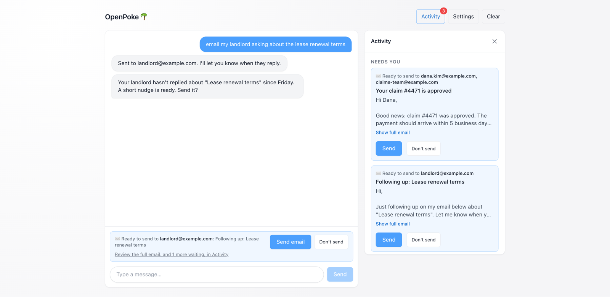
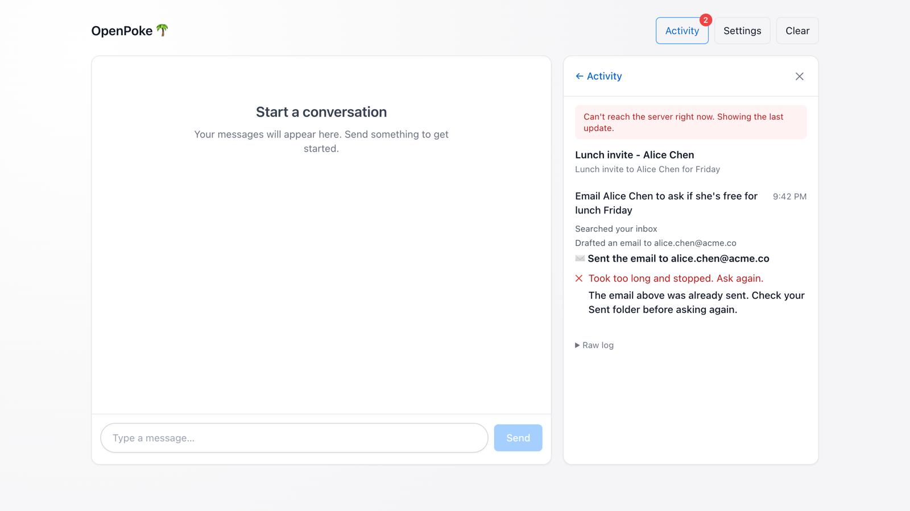
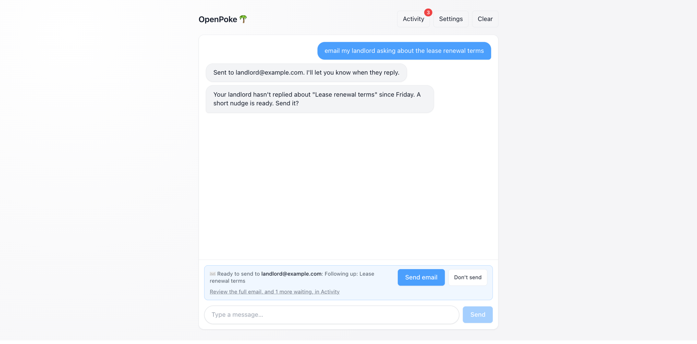
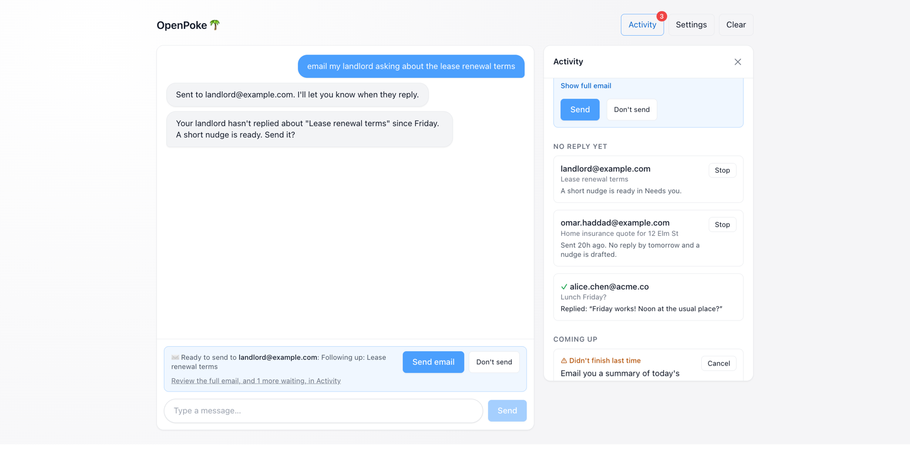

# Write-up

OpenPoke's interaction agent (Poke) hands each task to a named execution agent and keeps it, so
follow-ups go back to the agent that holds the thread. This fork makes routing hold up at
hundreds of agents, gives users a view of what Poke actually did, and makes Poke proactive about
the emails you're waiting on, with every outgoing email gated in code. Along the way I found and
fixed six bugs in the original, including two that broke it out of the box.

## Summary

- Part 1: on unclear requests, Poke went from 2/12 to 12/12 against the original, with clear
  requests unchanged at 40/40. Case and punctuation variants can no longer create duplicate agents, lookalikes are flagged, and
  at 500 agents the agent list in the prompt is 12× smaller and no longer grows.
- Part 2: an Activity panel built from what the code logged, not what the model says it did. It
  catches a double-send in the original: a task reported as failed after its email had already
  gone out.
- Part 3: Poke tracks the emails you send, tells you when people reply, and after 2 days of
  silence drafts a nudge in the thread for you to approve. Every outgoing email now needs your
  approval, enforced in code, which closes a path where an email with hidden instructions could
  talk the model into sending.

Evidence:
- 70 unit tests, with each fix broken on purpose to prove a test catches it (65 checks);
- a reproducible live eval against the original, committed with its raw results;
- real Gmail;
- two adversarial reviewers on different models, whose 31 findings all reproduced. Every one that
  affected a claim here is fixed, with a test.

## Part 1: Agent overload

### What was wrong

Poke routes with `send_message_to_agent(agent_name, instructions)`, and the name was the agent's
ID, its only description and its log filename.

1. The roster matched names exactly, so "email to alice" next to "Email to Alice" created a
   second agent with no history, and the two shared one log file.
2. A name was all Poke had to choose by. With "Alice Chen" and "Alice Wong", "did alice reply?"
   was a guess.
3. Every agent went into every prompt: about 24,300 characters at 500 agents, growing forever.

### What I built

- Agents are keyed by the slug that already names their log files, so case and punctuation
  variants always resolve to the same agent and can never create a duplicate. I kept names
  rather than adding IDs, so nothing migrates, and a mistyped name fails instead of landing on a
  different real agent.
- Each agent has a description and a last-used time. The prompt lists the 20 most recent, and
  `find_agents` searches the rest by shared words, weighting rare words higher (the IDF part of
  BM25). Keyword search over embeddings was deliberate. Poke writes the query, so the model
  already handles meaning, while keywords are free, deterministic, and never treat claims #4471
  and #4417 as close.
- An unknown name sends nothing and returns the closest matches. A new agent that looks like an
  existing one, including one outside the 20 Poke can see, is refused until Poke confirms it's
  separate work.
- If the user's words fit two agents equally, the code refuses the send and Poke has to ask. A
  word only one agent has ("chen"), or recent chat about one of them, settles it.

### Results

The evals ran 26 cases twice each against both versions, on `claude-sonnet-5.5` on the same day.
Scripts and raw results are in [`evals/`](evals/README.md), and anyone can rerun them.

| | Original | Mine |
|---|---|---|
| Clear requests (follow-ups, old agents, new work, several agents) | 40/40 | 40/40 |
| Unclear requests ("did alice reply?" with two Alices) | 2/12 | 12/12 |

- My version asked "which one?" every time the request was unclear. The original asked only on the one action case ("move the dentist appointment"). 
- On unclear questions the original messaged every matching agent in 8 of 10 runs, which costs a worker per match and hands the user a mixed answer, and picked one in the other 2.  My version resolved every unclear request with one short question.
- Clear requests held at 40/40 while the prompt stopped growing. Measured by rendering both versions' agent list, the list at 500 agents went from 24,300 to 2,100 characters and stays flat from about 50 agents up.
- Neither version created a duplicate in the live runs. The lookalike check is what stopped "Tokyo flight status" from becoming a second Tokyo agent on a day the model often skipped searching.

## Part 2: Activity panel

### What was missing

The chat was the only view, and the chat is the model's account of what happened. Each agent's
steps were logged to disk, but nothing showed them. Reminders could only be seen or cancelled by
asking Poke.

That account can be wrong in the worst way. If a worker sent an email and then hit the
90-second timeout, the original reported the task as failed and never logged the timeout. The
user would ask again, and the email could go out twice.

### What I built

- `server/services/activity.py` turns each agent's log into a timeline: one entry per request,
  each step in plain words, and an outcome the model can't misreport. Timeouts are now logged.
- The panel has four sections: emails waiting for approval (with every recipient, bcc included),
  sent emails with no reply yet, upcoming reminders with Cancel and Undo, and recent tasks with
  their full timelines.
- When an email is waiting, the chat shows Send email and Don't send above the input, like
  suggested replies in a text thread.

### Decisions

- Build from the logs, not the model's summary, because they disagree exactly when it matters.
  In the timeout case the panel shows the send and warns: "The email above was already sent.
  Check your Sent folder before asking again."
- Put the panel beside the chat, not inside it. Poke is a text thread, like SMS, and a task list
  doesn't belong in a thread. The one thing that needs a quick answer, an approval, does appear
  in the chat.
- Leave out live streaming (polling is enough), editing reminders in the panel (chat does it),
  and search.

`tests/test_activity.py` has 18 tests built from real log shapes. They cover a send surviving a
failed task, a timeout showing as failed rather than working, a reminder running once across a
restart, and a daylight-saving jump not breaking a running task. I also checked the panel in a
browser at desktop and phone widths.

## Part 3: Follow-ups when someone doesn't reply

Following up is easy to forget, and in insurance much of the work is waiting on someone: a
customer's photos, a signature, an adjuster's answer. General Magic's agents solve that for
insurers. This feature solves it for one person, and it's the first time Poke acts on outgoing
email without being asked.

1. You email Dana through Poke, and Poke starts tracking the thread.
2. After 2 days with no reply, Poke drafts a short nudge in the same thread and texts you: *"Dana
   hasn't replied about claim #4471 since Tuesday. A short nudge is ready. Send it?"*
3. You say yes and it's sent. When Dana replies, Poke tells you and quotes her first line. If
   the nudge gets no reply either, Poke tells you once and lets it go.

It has the safeguards business texting needs: one nudge at most, nothing between 10pm and 8am,
and "stop chasing Dana" ends it. Checking for replies is a Gmail search every 5 minutes with no
model calls, so it costs nothing and gives the same answer every time.

### Built on: approval enforced in code

Poke drafting emails on its own is only safe if nothing sends without a yes. The original's only
check was a line in the prompt, which a model can skip and an email with hidden instructions can
talk it past. So I built the gate first, and it covers every outgoing email, not just nudges.

- The send, reply and forward tools create a request instead of sending. The user approves in
  chat, with the chat buttons, or in the panel. A chat approval only counts on a turn the user
  started, so an agent's report can never approve a send.
- A request is claimed under a lock before sending, so it sends at most once, even with five
  approvals at the same moment. A send cut off by a restart is marked failed and never retried.
- Emails only to yourself skip approval, so scheduled summaries keep working.

With the real model, 3 runs each, "yes send it" sent exactly one email and "actually make it 1pm"
sent nothing, 6 of 6 correct. The gate has 17 unit tests and follow-ups have 9.

## Bugs found and fixed in the original

- The default model, `anthropic/claude-sonnet-4`, had been retired, so every message failed. The
  default is now `claude-sonnet-5.5`.
- Newer models called `wait` until they hit the 8-step limit, so about 1 in 3 turns ended in an
  error. A step that only waits now ends the turn.
- A restart mid-run fired reminders twice. The scheduler now claims a reminder before running it.
- The important-email watcher made a blocking Gmail call on the server's event loop, so one hung
  connection froze the whole server. It now runs in a thread, with a test.
- A task that timed out after sending an email was reported as failed, inviting a second send
  (Part 2).
- Every call reserved 65,536 output tokens, which fails on low-balance keys. It's now 4,096.

## With another week

1. Run the follow-up loop end to end with real people. So far the real-reply path has run
   against fakes and demo data, and sending and Gmail search have run for real.
2. Scale the routing evals to 500 to 1,000 agents, with insurance look-alikes and test cases
   written by someone who hasn't seen the code.
3. Let users stop a task that's already running from the panel.
4. Match replies to the thread rather than the sender, and have Poke write each nudge from the
   thread.
5. Before real users: auth, a database instead of JSON files, and a cap on each agent's history.

All 70 tests run without API keys: `python -m pytest tests -q`.
